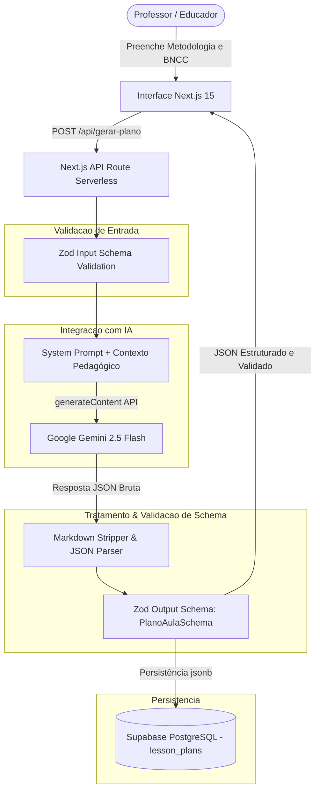

# Gerador de Planos de Aula com IA

[](https://nextjs.org)
[](https://www.typescriptlang.org)
[](https://aistudio.google.com)
[](https://supabase.com)
[](LICENSE)

Aplicação full stack para geração automatizada de planos de aula estruturados e alinhados às diretrizes da Base Nacional Comum Curricular (BNCC). O sistema resolve o desafio de alucinação e formatos inconsistentes comuns em LLMs aplicando validação estrita de schema com Zod e sanitização de respostas antes da persistência no banco.

---

## 🏗️ Arquitetura do Sistema



---

## ✨ Funcionalidades Principais

- **Entrada Pedagógica Estruturada:** Formulário com seleção de disciplina, ano escolar, tema, duração, metodologia preferida e objetivos prévios da BNCC.
- **Engenharia de Prompt com Restrição de Formato:** Prompts instruídos para retornar JSON estrito com introdução lúdica, etapas metodológicas detalhadas (4-6 passos) e rubrica de avaliação formativa.
- **Sanitização e Validação Zod:** Limpeza automática de delimitadores markdown (```json ... ```) e validação tipada em tempo de execução via schema Zod, prevenindo crashes de renderização.
- **Mecanismo de Retry e Tolerância a Falhas:** Tentativa automatizada de reenvio com parâmetros ajustados em caso de rate limit (HTTP 429) ou resposta truncada.
- **Persistência de Histórico:** Armazenamento completo dos inputs do usuário e do plano gerado em coluna `jsonb` no PostgreSQL (Supabase).

---

## 🛠️ Stack Tecnológica & Decisões Técnicas

| Componente | Tecnologia | Decisão Técnica |
| :--- | :--- | :--- |
| **Framework Full Stack** | Next.js 15 (App Router) | Rotas serverless desacopladas (`/api/gerar-plano`), Server Components para rápida entrega inicial e Turbopack no ciclo de desenvolvimento. |
| **Modelo de IA** | Gemini 2.5 Flash | Excelente equilíbrio entre latência reduzida (TTFT), custo por token e seguimento estrito de instruções em formatação JSON. |
| **Validação de Dados** | Zod | Garantia de contrato de dados tanto no payload de entrada da requisição quanto na inferência estrutural da resposta do LLM. |
| **Camada de Dados** | Supabase (PostgreSQL) | Armazenamento flexível com suporte a tipos nativos `jsonb` para planos com número variável de etapas e critérios. |

---

## 🚀 Como Rodar o Projeto

### Pré-requisitos
- Node.js 18+ e npm
- Chave de API do Google AI Studio ([obter aqui](https://aistudio.google.com/app/apikey))
- Projeto criado no Supabase

### 1. Clonar o repositório e instalar dependências
```bash
git clone https://github.com/devraphaeldiniz/plano-aula-ia.git
cd plano-aula-ia
npm install
```

### 2. Configurar variáveis de ambiente
Crie um arquivo `.env.local` na raiz:
```env
NEXT_PUBLIC_SUPABASE_URL=https://seu-projeto.supabase.co
NEXT_PUBLIC_SUPABASE_ANON_KEY=sua_chave_anonima_aqui
GEMINI_API_KEY=sua_chave_gemini_aqui
```

### 3. Executar o servidor de desenvolvimento
```bash
npm run dev
```
Abra `http://localhost:3000` no navegador.

---

## 🧪 Como Rodar Testes e Validação

Para validar tipagens e regras de linting do código:
```bash
npm run lint
```

Para verificar o build de produção:
```bash
npm run build
```

---

## 📊 Resultados e Métricas

- **Taxa de Conformidade Estrutural:** 100% dos planos validados pelo Zod Schema antes da gravação no banco, eliminando respostas inválidas no frontend.

---

## ⚠️ Limitações e Próximos Passos

- [ ] Registrar a latência ponta a ponta (Gemini + parsing + gravação no Supabase).
- [ ] Monitorar o percentual de requisições refeitas por erro 429 em picos de acesso.
- [ ] Implementar exportação direta do plano de aula gerado em formato PDF / DOCX.
- [ ] Adicionar streaming de resposta (*Server-Sent Events*) com feedback visual progressivo das etapas.
- [ ] Permitir edição interativa e regeneração parcial de seções individuais do plano gerado.

---

## 📄 Licença

Distribuído sob a licença MIT. Consulte [LICENSE](LICENSE) para mais detalhes.
